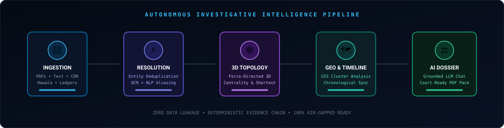
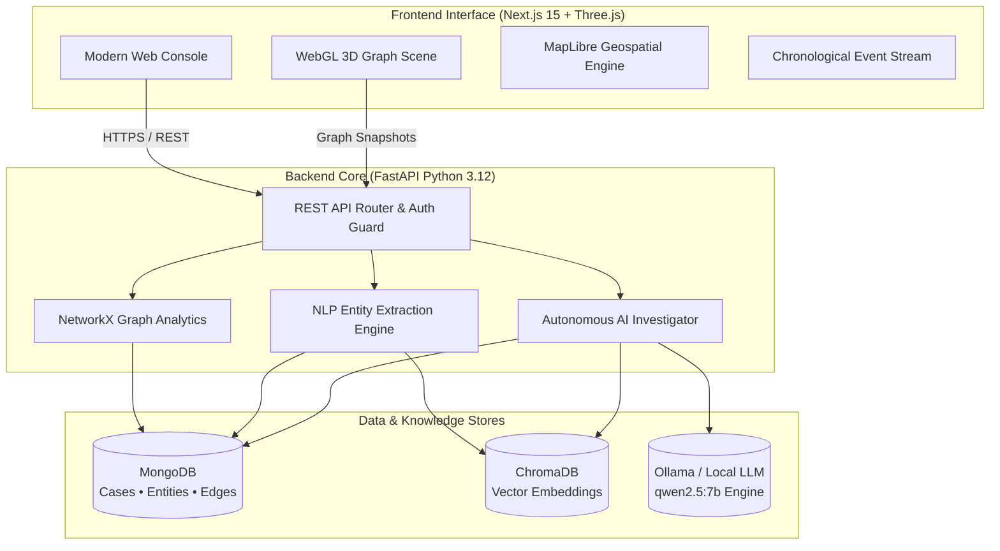

<div align="center">

<!-- HERO BANNER -->


<br/>

<!-- ANIMATED TYPING SUBTITLE -->
<a href="https://github.com/ASTA91-GIT/Nexus">
  
</a>

<p align="center">
  <b>Smart India Hackathon 2026</b> &bull; Problem Statement: <code>SIH26189</code><br/>
  <b>Ministry of Home Affairs &bull; National Crime Records Bureau (NCRB)</b><br/>
  <i>Women Safety Division &bull; Theme: Blockchain &amp; Cybersecurity</i>
</p>

<!-- BADGES BAR -->
<p align="center">
  <a href="#-technical-architecture"></a>
  <a href="#-technical-architecture"></a>
  <a href="#-technical-architecture"></a>
  <a href="#-quick-start"></a>
  <a href="#-tests--validation"></a>
</p>

<!-- QUICK NAVIGATION -->
<p align="center">
  <a href="#-overview"><b>Overview</b></a> &bull;
  <a href="#-interactive-visual-demonstrations"><b>Live Demos</b></a> &bull;
  <a href="#-autonomous-investigation-pipeline"><b>Pipeline</b></a> &bull;
  <a href="#-key-capabilities"><b>Features</b></a> &bull;
  <a href="#-technical-architecture"><b>Architecture</b></a> &bull;
  <a href="#-demo-scenario-operation-shadow-ledger"><b>Demo Case</b></a> &bull;
  <a href="#-quick-start"><b>Quick Start</b></a> &bull;
  <a href="#-api-endpoints"><b>API Reference</b></a> &bull;
  <a href="#-team--acknowledgments"><b>Team</b></a>
</p>

---

</div>

## 🌐 Overview

Modern criminal syndicates operate across fragmented channels—shell companies, hawala networks, encrypted communication hops, mule bank accounts, and disparate geographic safehouses. Traditional manual cross-referencing between disconnected files leaves investigators overwhelmed with data noise and blind spots.

**NEXUS** transforms disparate, unstructured investigative data into an interconnected **3D Topological Intelligence Graph**, backed by **RAG-grounded conversational AI**, **spatial-temporal tracking**, and **autonomous entity resolution**.

```
[Raw Documents / Evidence] ──> [Entity Extraction & Aliasing] ──> [3D Knowledge Graph] 
                                                                          │
[Audit Dossier & Court PDF] <── [Grounded AI Reasoning] <── [Spatial-Temporal GIS]
```

### 🎯 Key Objectives:
- **Unified Single Pane of Glass**: Consolidate suspects, organizations, mule accounts, phone numbers, and physical evidence into isolated case workspaces.
- **Autonomous Link Discovery**: Calculate multi-hop connections, betweenness centrality, and shortest criminal paths between conspirators.
- **Strict Grounding & Zero Hallucination**: AI assistant answers strictly from verified case facts and evidence documents with auditable citation chains.
- **Court-Ready Transparency**: Export comprehensive investigation dossiers with high-resolution graph snapshots, alert history, and chronological event timelines.

---

## 🎬 Interactive Visual Demonstrations

### 1. 🕸️ 3D Criminal Network Topology & Shortest Path Tracer
NEXUS models criminal interactions as a dynamic 3D force-directed multigraph. Below is the automated pathfinder isolating a laundering conspiracy chain from **Aarav Malhotra** to **Vikram Singhania** (`0.94 Risk`):

<div align="center">
  
</div>

<br/>

### 2. 🤖 Conversational AI Investigator (RAG + Graph Reasoning)
Investigators can query the case in natural English. NEXUS synthesizes data across the relationship graph and vector evidence stores with full citation integrity:

<div align="center">
  
</div>

<br/>

### 3. ⚡ Zero-Terminal Orchestration & Service Startup
A single command orchestrates MongoDB, ChromaDB, the local Ollama LLM, FastAPI, and the Next.js Web Console:

<div align="center">
  
</div>

---

## ⚡ Autonomous Investigation Pipeline

<div align="center">
  
</div>

<br/>

| Stage | Subsystem | Functional Scope |
|---|---|---|
| **1. Ingestion** | `app/api/routes/evidence.py` | Multi-format upload (PDFs, text files, CDR logs), MIME validation, automated text chunking. |
| **2. Resolution** | `app/services/relationship_resolver.py` | NLP-driven entity recognition, deduplication, phonetic matching, and cross-evidence linking. |
| **3. 3D Topology** | `frontend/src/three/NetworkScene.tsx` | Force-directed 3D graph layout, degree weighting, betweenness centrality, community clusters. |
| **4. Geo/Time Fusion** | `frontend/src/app/locations` & `timeline` | Interactive GIS mapping, coordinates clustering, and chronological sequence reconstruction. |
| **5. AI Reasoner** | `app/ai/investigator_agent.py` | Strict RAG context retrieval, persona grounding, innocent disposition workflows, and path tracing. |
| **6. Legal Reporting** | `components/reports/CaseReportPDF.tsx` | Export court-compliant intelligence reports with embedded network topology snapshots. |

---

## 🚀 Key Capabilities

### 1. 🕸️ Interactive 3D Criminal Network Topology
- **Force-Directed WebGL Rendering**: High-performance 3D scene built with Three.js (React Three Fiber) supporting hundreds of simultaneous nodes.
- **Visual Risk Hierarchy**: Dynamic node coloring, glowing halos, and scale pulsing based on computed threat scores.
- **Shortest Path & Concurrency Analysis**: Instantly compute and highlight transaction hops between two targeted suspects.
- **Interactive Graph Editor**: Add, modify, or unlink entities and relationships directly on the canvas.

### 2. 🤖 Conversational AI Investigator (RAG + Graph Reasoning)
- **Local & Air-Gapped Ready**: Integrates seamlessly with Ollama (`qwen2.5:7b`), HuggingFace, or custom LiteLLM endpoints.
- **Auditable Citation Trail**: Every answer returns exact evidence documents, entity database IDs, and confidence levels.
- **Innocent Disposition Flow**: Dedicated investigative status handling allowing cleared subjects to be marked as `CLEARED / INNOCENT (Free to Go)` without breaking the historical graph topology.
- **Evidence Gap Detection**: Identifies uncorroborated allegations and flags investigative blind spots.

### 3. 🗺️ Geospatial & Temporal Intelligence
- **Vector-Tile GIS Mapping**: Interactive MapLibre/Leaflet maps visualizing location-tagged entities, safehouses, and rendezvous spots.
- **Chronological Sequence Reconstruction**: Unified timeline aggregating document timestamps, communication logs, and financial ledger dates.
- **Fullscreen & Focus Controls**: Expandable map views with quick centering and coordinates inspection.

### 4. 🛡️ Enterprise Security & Case Isolation
- **Multi-Tenant Case Scoping**: Strict boundary isolation ensuring investigations never leak evidence across cases.
- **JWT & Role-Based Access Control**: Secure bcrypt password encryption and protected API endpoints.
- **Comprehensive Audit Trail**: Real-time logging of user logins, case modifications, and node creation events.

---

## 🏛️ Technical Architecture



---

## 📂 Project Structure

```text
NEXUS/
├── 📁 frontend/                       # Next.js 15 React application
│   ├── src/
│   │   ├── app/                       # App Router (dashboard, network, investigate, etc.)
│   │   ├── components/                # Modular UI widgets & PDF dossier generator
│   │   ├── lib/                       # API clients & network snapshot utilities
│   │   └── three/                     # Three.js 3D force-directed graph engine
│   └── package.json
│
├── 📁 backend/                        # FastAPI Python 3.12 microservice
│   ├── app/
│   │   ├── ai/                        # AI investigator agent & local LLM adapters
│   │   ├── api/routes/                # Endpoints (cases, entities, evidence, AI, timeline)
│   │   ├── core/                      # Database connectors & security settings
│   │   ├── schemas/                   # Pydantic validation models
│   │   └── services/                  # Entity extraction, deduplication & RAG
│   ├── tests/                         # Pytest test suites (11/11 passing)
│   └── requirements.txt
│
├── 📁 docs/                           # Documentation & animated vector assets
│   └── images/                        # SVG banners, diagrams & animated demos
│
├── 🐳 docker-compose.yml              # Multi-container orchestration (FastAPI + Mongo + Ollama)
├── ⚡ Start-NEXUS.bat                  # One-click Windows launcher
├── 🚀 run_dev.bat / run_dev.ps1       # Native dev launchers
└── 📄 README.md                       # Master project guide
```

---

## 🎬 Demo Scenario: "Operation Shadow Ledger"

NEXUS includes a comprehensive **demonstration dataset** modeled on complex financial and smuggling syndicates to showcase the full analytical cycle:

```
[Aarav Malhotra (Suspect)] ────> [Account ACC-78421] ────> [Wire Transfer $450,000]
                                                                  │
[Apex Meridian Trading] <──── [Hawala Node ACC-55218] <──────────┘
          │
          └────> [Dubai Logistics Hub] ────> [Vikram Singhania (Kingpin)]
```

### Sample Investigative Inquiries:
- *"Who is the most central figure in Operation Shadow Ledger?"*
- *"Trace the financial flow between Aarav Malhotra and Apex Meridian Trading."*
- *"What locations are linked to Vikram Singhania?"*
- *"Are there any unverified claims or evidence gaps in this case?"*

> **Notice:** *Operation Shadow Ledger is strictly fictional demonstration data prepared for Smart India Hackathon evaluation.*

---

## 💻 Quick Start

### Option 1: Docker Desktop (Recommended - Zero Terminal Setup)

1. Ensure **Docker Desktop** is running on your machine.
2. Launch the pre-configured script:
   - **Windows:** Double-click [`Start-NEXUS.bat`](Start-NEXUS.bat) or run `.\docker_start.bat`
   - **Linux / macOS:** Run:
     ```bash
     docker compose up -d
     ```
3. Open your browser:
   - **Frontend Console:** [http://localhost:3000](http://localhost:3000)
   - **FastAPI Documentation:** [http://localhost:8000/docs](http://localhost:8000/docs)

---

### Option 2: Native Development Setup

#### 1. Backend (FastAPI + Python 3.12)
```bash
# Navigate to backend directory
cd backend

# Create and activate virtual environment
python -m venv venv
# Windows:
.\venv\Scripts\activate
# Linux/macOS:
source venv/bin/activate

# Install dependencies
pip install -r requirements.txt

# Run backend server
uvicorn app.main:app --reload --port 8000
```

#### 2. Frontend (Next.js 15)
```bash
# Navigate to frontend directory
cd frontend

# Install packages
npm install

# Start Next.js development server
npm run dev
```

#### 3. Environment Variables
Create a `.env` file in the `backend/` directory:
```env
MONGODB_URI=mongodb://localhost:27017
DATABASE_NAME=nexus
JWT_SECRET=super_secret_jwt_key_sih_2026
NEXUS_LOCAL_AI_URL=http://localhost:11434
NEXUS_LOCAL_AI_MODEL=qwen2.5:7b
FRONTEND_URL=http://localhost:3000
```

---

## 🧪 Tests & Validation

NEXUS includes automated test suites covering graph traversal, intent classification, and evidence reasoning:

```bash
cd backend
.\venv\Scripts\python -m pytest tests/test_investigator_pipeline.py -v
```

```text
tests/test_investigator_pipeline.py::test_clean_query_text PASSED               [  9%]
tests/test_investigator_pipeline.py::test_extract_target_name PASSED            [ 18%]
tests/test_investigator_pipeline.py::test_resolve_entity_alias PASSED           [ 27%]
tests/test_investigator_pipeline.py::test_format_entity_link PASSED             [ 36%]
tests/test_investigator_pipeline.py::test_format_entity_profile PASSED          [ 45%]
tests/test_investigator_pipeline.py::test_format_relationships PASSED           [ 54%]
tests/test_investigator_pipeline.py::test_format_path_response PASSED           [ 63%]
tests/test_investigator_pipeline.py::test_format_case_summary PASSED            [ 72%]
tests/test_investigator_pipeline.py::test_evidence_gaps PASSED                  [ 81%]
tests/test_investigator_pipeline.py::test_end_to_end_agent PASSED               [ 90%]
tests/test_investigator_pipeline.py::test_all_cases_aggregation PASSED          [100%]
============================== 11 passed in 13.00s ==============================
```

---

## 🔌 API Endpoints

| Category | Endpoint | Method | Description |
|---|---|---|---|
| **Auth** | `/api/auth/register` | `POST` | Register a new investigator profile |
| **Auth** | `/api/auth/token` | `POST` | Authenticate and obtain JWT bearer token |
| **Cases** | `/api/cases/` | `GET / POST` | List or create isolated investigation cases |
| **Entities** | `/api/entities/` | `GET / POST` | Manage suspects, orgs, accounts, and locations |
| **Network** | `/api/relationships/` | `GET / POST` | Query or link directional criminal edges |
| **AI** | `/api/ai/investigate` | `POST` | Natural-language query to AI Investigator |
| **Evidence** | `/api/evidence/upload` | `POST` | Securely ingest investigation files |
| **Timeline** | `/api/timeline/{case_id}` | `GET` | Chronological multi-source event sequence |
| **Alerts** | `/api/alerts/{case_id}` | `GET` | Retrieve risk alerts & anomalous nodes |

---

## 👥 Team & Acknowledgments

**Smart India Hackathon 2026** &bull; **Team Quantum Coders**

- **Problem Statement ID:** `SIH26189`
- **Nodal Agency:** National Crime Records Bureau (NCRB)
- **Ministry:** Ministry of Home Affairs, Government of India
- **Repository:** [ASTA91-GIT/Nexus](https://github.com/ASTA91-GIT/Nexus)

<div align="center">
  <sub>Built with ❤️ for law enforcement, intelligence analysts, and women safety by Team Quantum Coders.</sub>
</div>
